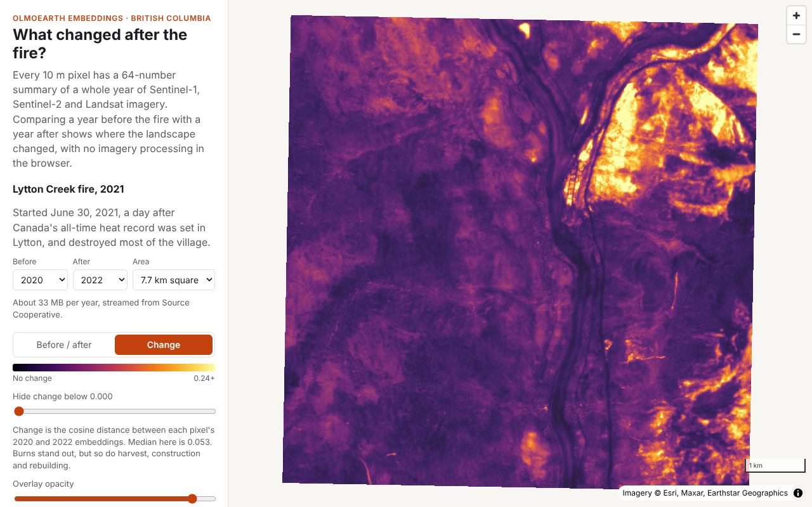

# BC Burn Embeddings

What changed after a wildfire in British Columbia, using [OlmoEarth v1.3 Embeddings](https://source.coop/olmoearth/olmoearth-v1-3-embeddings) read live from Source Cooperative in the browser.



## What it does

The first feature is a **change map** for the 2021 Lytton Creek fire:

- **Before / after.** Two years of embeddings are shown as false colour (the top three principal components, fitted on both years together so colours are comparable). Drag the slider to swipe between them.
- **Change.** Each pixel's cosine distance between the before and after embeddings, with a threshold to hide small changes and a readout under the cursor.

Defaults compare 2020 with 2022. Each embedding summarises a whole calendar year, so the fire year itself mixes pre- and post-fire conditions.

## How it works

- The store is Zarr v3 (one group per UTM zone, sharded, zstd). [zarrita](https://github.com/manzt/zarrita.js) reads it straight from `https://data.source.coop` with HTTP range requests. No server, no API key.
- Only bands 0–63 are read. They form a complete 64-dimensional Matryoshka embedding and halve the download.
- The window is aligned to the store's 256 px inner chunks, so each request is one chunk and nothing is wasted. A 7.7 km square is ~33 MB per year.
- Values are dequantized with the README's signed square-root scheme (`sign(q)·(|q|/127.5)²`, `-128` = nodata) and L2-normalised before any comparison.

Code map:

| File | Purpose |
|---|---|
| `src/config.ts` | Dataset URL, fires, window sizes |
| `src/lib/embeddings.ts` | Zarr reads with progress |
| `src/lib/grid.ts` | Lon/lat ↔ UTM pixel window, corner coordinates |
| `src/lib/analysis.ts` | Dequantization, cosine distance, PCA colouring |
| `src/components/MapView.tsx` | MapLibre map with the embedding overlay |

## Develop

```sh
npm install
npm run dev      # http://localhost:5173
npm test         # unit tests for dequantization, distance, PCA and grid maths
npm run build    # static site in dist/
```

## Deploy

`.github/workflows/deploy.yml` builds and publishes to GitHub Pages on every push to `main`. In the repo, set **Settings → Pages → Build and deployment → Source** to **GitHub Actions** once.

The Vite `base` is relative (`./`), so the site works at `https://<user>.github.io/<repo>/` without configuration.

## Adding a fire

Add an entry to `FIRES` in `src/config.ts` with its UTM zone, a centre point and default before/after years.

## Credits and licences

- Embeddings: OlmoEarth v1.3 Embeddings, Allen Institute for AI, under the OlmoEarth Artifact License. Please cite the OlmoEarth v1.3 Embeddings paper.
- Basemap: Esri World Imagery and Boundaries & Places.
